# PaperManga

Прошивки для читалок **ESP32, ESP32-S3 и ESP32-C3** и приложения для **Kobo, PocketBook и Android**: каталог манги, библиотека и чтение XTC/XTCH. Варианты с PSRAM готовят главы прямо на читалке; старые X4 и X3 получают ч/б XTC, подготовленный на компьютере.

**Установить:** https://ikrasnodymov.github.io/papermanga/ (Chrome или Edge на компьютере, читалка по USB).

**Выберите точную модель и аппаратную ревизию.** Работа проверена на нашем X4 Classic с UC8279; все новые порты экспериментальные и **не проверены на устройствах**. Успешная компиляция не подтверждает работу экрана, сенсора, сна, зарядки или батареи.

## Выбор прошивки и статус проверки

На нашем X4 Classic с UC8279 работа проверена на устройстве. Последняя установленная версия, указанная в журнале проверки, — 0.2.4; для этой модели сохранён опубликованный вариант 0.2.5 без изменения бинарников. Все порты 0.3.0 экспериментальные: они прошли сборку и программные проверки, но не проверялись на физическом устройстве.

| Устройство и установка | Версия | Проверка | Ограничения |
| --- | --- | --- | --- |
| [Xteink X4 Classic](https://ikrasnodymov.github.io/papermanga/?device=x4c#install) | 0.2.5 | Модель проверена: UC8279, PaperManga 0.2.4 | Проверено на нашем X4 Classic с UC8279. Другие панели и аппаратные ревизии не проверены. |
| [Xteink X4 Classic · экспериментальная 0.3](https://ikrasnodymov.github.io/papermanga/?device=x4c_all#install) | 0.3.0 | **На устройстве не проверено**; компиляция прошла | На устройстве не проверено. Автовыбор SSD1677/UC8179/UC8279. Самостоятельная прошивка без соседнего CrossPoint; проверенный вариант Classic доступен отдельно. |
| [Xteink X4 Pro Developer Edition](https://ikrasnodymov.github.io/papermanga/?device=x4pro#install) | 0.3.0 | **На устройстве не проверено**; компиляция прошла | На устройстве не проверено. SSD1677, UC8179 и UC8279 выбираются аппаратным профилем. Нужна Developer Edition. |
| [M5Stack PaperS3](https://ikrasnodymov.github.io/papermanga/?device=papers3#install) | 0.3.0 | **На устройстве не проверено**; компиляция прошла | На устройстве не проверено. Навигация через сенсор, панель ED047TC1. Возможности зависят от ревизии платы. |
| [Seeed reTerminal Sticky](https://ikrasnodymov.github.io/papermanga/?device=sticky#install) | 0.3.0 | **На устройстве не проверено**; компиляция прошла | На устройстве не проверено. Передача глав по Wi-Fi или через карту. USB используется для прошивки, режим USB-диска недоступен. |
| [M5Stack Paper Mono](https://ikrasnodymov.github.io/papermanga/?device=papermono#install) | 0.3.0 | **На устройстве не проверено**; компиляция прошла | На устройстве не проверено. Сенсор FT6336G, подсветка и питание через M5PM1. Качество серых тонов требует проверки. |
| [LilyGO T5 E-Paper S3 Pro](https://ikrasnodymov.github.io/papermanga/?device=lilygo_t5s3#install) | 0.3.0 | **На устройстве не проверено**; компиляция прошла | На устройстве не проверено. Только T5 S3 Pro с ED047TC1, TPS65185 и PCA9535; другие T5 не совместимы. |
| [Waveshare ESP32-S3-ePaper-3.97](https://ikrasnodymov.github.io/papermanga/?device=ws397#install) | 0.3.0 | **На устройстве не проверено**; компиляция прошла | На устройстве не проверено. Профиль рассчитан на AXP2101; документация также описывает TG28. Сверьте контроллер питания своей платы. |
| [Read Pico](https://ikrasnodymov.github.io/papermanga/?device=read_pico#install) | 0.3.0 | **На устройстве не проверено**; компиляция прошла | На устройстве не проверено. Используется заводской BSP и VCOM из PMU. Только Read Pico с экраном 1216×684. |
| [Metalio E-Ink 4](https://ikrasnodymov.github.io/papermanga/?device=metalio_eink4#install) | 0.3.0 | **На устройстве не проверено**; компиляция прошла | На устройстве не проверено. Только E-Ink 4 3,97″; E-Ink 4 Plus не совместим. Есть расхождения распиновки в исходниках производителя. |
| [BOOX Picco](https://ikrasnodymov.github.io/papermanga/?device=picco#install) | 0.3.0 | **На устройстве не проверено**; компиляция прошла | На устройстве не проверено. Экспериментальный аппаратный профиль; сенсор пока не поддерживается. Возможность прошивки зависит от загрузчика. |
| [M5Paper v1.1](https://ikrasnodymov.github.io/papermanga/?device=m5paper#install) | 0.3.0 | **На устройстве не проверено**; компиляция прошла | На устройстве не проверено. Классический ESP32 с IT8951. Это не PaperS3. Передача глав по Wi-Fi или через карту. |
| [Inkplate 6](https://ikrasnodymov.github.io/papermanga/?device=inkplate6#install) | 0.3.0 | **На устройстве не проверено**; компиляция прошла | На устройстве не проверено. Только Inkplate 6 800×600 на ESP32-WROVER; 6 Plus и 6 Motion не совместимы. |
| [Xteink X4 ESP32-C3](https://ikrasnodymov.github.io/papermanga/?device=x4#install) | 0.3.0 | **На устройстве не проверено**; компиляция прошла | На устройстве не проверено. Облегчённая ч/б версия: главы готовит компьютер. Это старый X4, не X4 Classic. |
| [Xteink X3](https://ikrasnodymov.github.io/papermanga/?device=x3#install) | 0.3.0 | **На устройстве не проверено**; компиляция прошла | На устройстве не проверено. Облегчённая ч/б версия: главы готовит компьютер. Панели UC8253/UC8279d требуют проверки. |

На сайте выберите точную модель: у каждой платы свой установочный манифест. X3 и старый X4 используют ч/б XTC, подготовленный на компьютере. Варианты 0.3.0 работают самостоятельно; соседний CrossPoint сохраняется только в прежнем варианте X4 Classic. Inkplate 6 с 4 МБ flash обновляется по USB через сайт. Сенсор: свайпы перемещают выбор, касание выбирает, нижняя панель предоставляет кнопки. BOOX Picco пока использует физические кнопки: короткие ▲/▼, удержание ◀/▶, короткое ОК выбирает, удержание ОК возвращает назад.

## Приложения Kobo, PocketBook и Android — 0.4.0

**Все три не проверены на физических устройствах.** Сборки и программные тесты прошли; Android запущен в эмуляторе. Экран, касания, сон и батарея конкретных ридеров ещё не подтверждены.

| Приложение | Файл | Совместимость первой сборки |
|---|---|---|
| Kobo | [ZIP](https://github.com/IKrasnodymov/papermanga/releases/download/v0.4.0/papermanga-kobo-0.4.0.zip) | Сенсорный Kobo Linux ARM32 + NickelMenu |
| PocketBook | [ZIP](https://github.com/IKrasnodymov/papermanga/releases/download/v0.4.0/papermanga-pocketbook-0.4.0.zip) | PocketBook OS / InkView ARM32 Linux |
| Android | [APK](https://github.com/IKrasnodymov/papermanga/releases/download/v0.4.0/papermanga-android-0.4.0.apk) | Android 7.0+; ARM64 / ARM32 / x86_64 |

[Инструкции установки и ограничения моделей](docs/APPLICATIONS.md). Приложения читают XTC/XTCH, сохраняют историю и готовят главы из каталога под доступную область экрана. PocketBook на Android использует APK; Linux ARM64, включая InkPad One, не входит в ARM32-пакет.

[apps.json: SHA-256 и статусы](https://github.com/IKrasnodymov/papermanga/releases/download/v0.4.0/apps.json) · [Лицензии и исходники библиотек](https://github.com/IKrasnodymov/papermanga/releases/download/v0.4.0/papermanga-apps-0.4.0-third-party.zip).

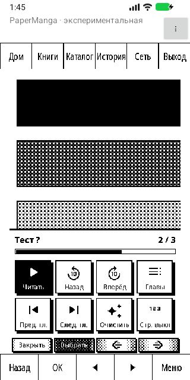

Android в эмуляторе, тестовая глава.

## Как это выглядит

Снимки экрана один в один, как их показывает читалка (480×800, четыре оттенка серого). Главы на снимках — демонстрационные.

| Главный экран | Библиотека | Каталог |
|:---:|:---:|:---:|
| 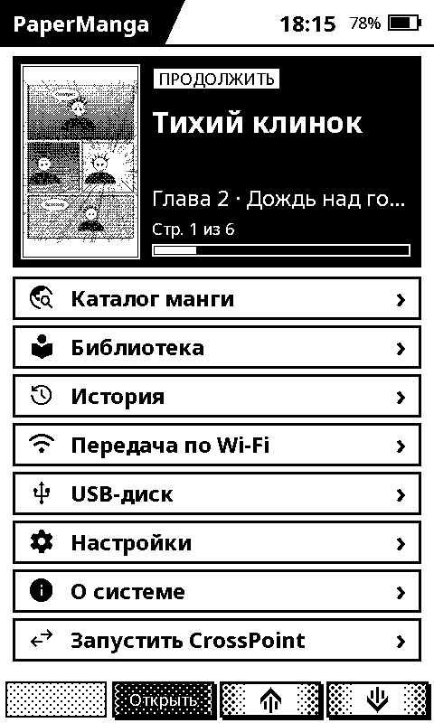 | 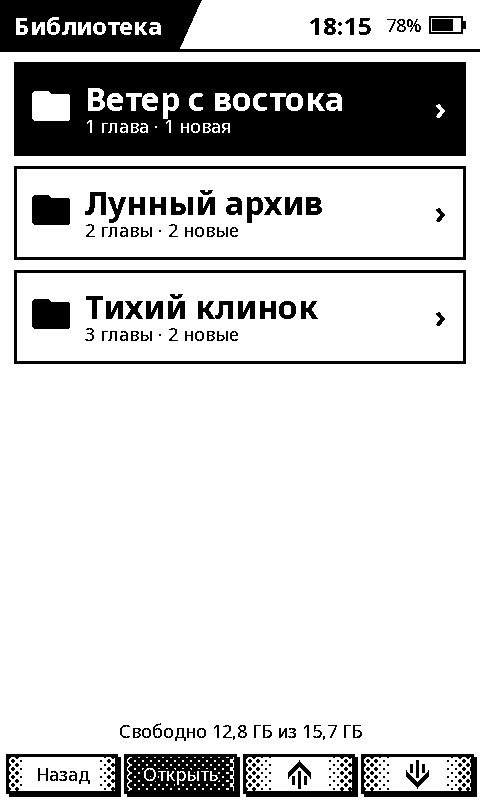 | 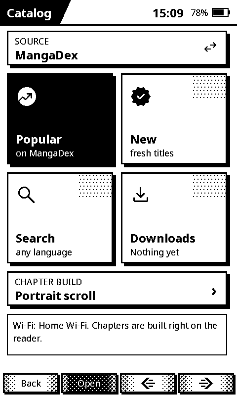 |
| **Чтение** | **Меню чтения** | **Конец главы** |
| 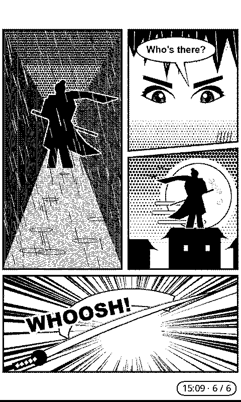 | 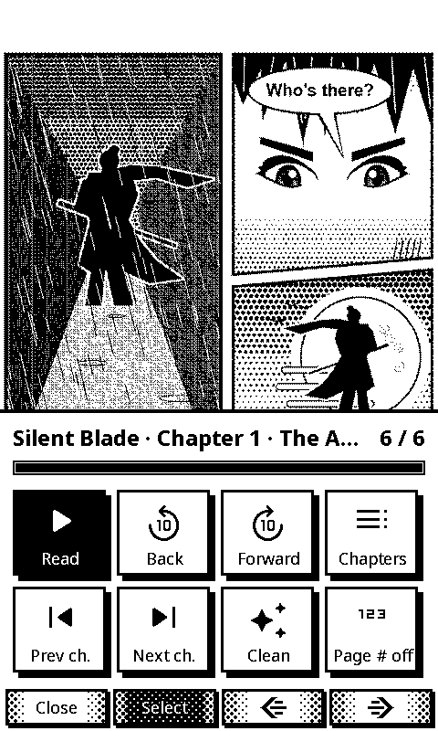 | 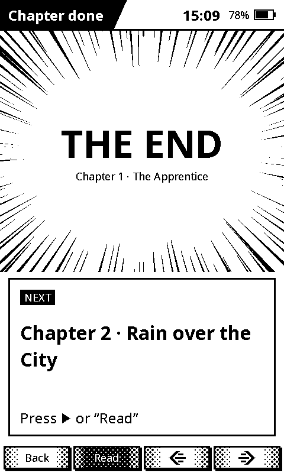 |
| **Главы** | **Сборка глав** | **Удаление** |
| 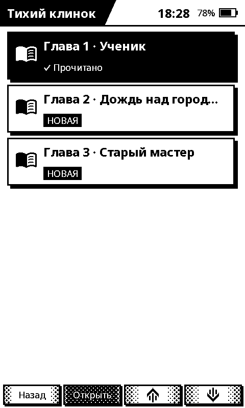 | 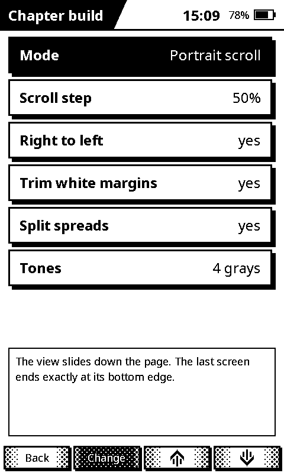 | 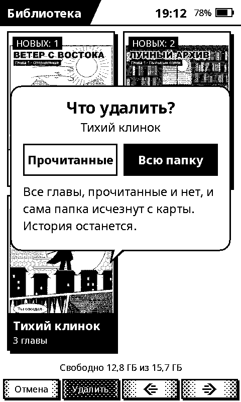 |
| **Wi‑Fi** | **О системе** | |
| 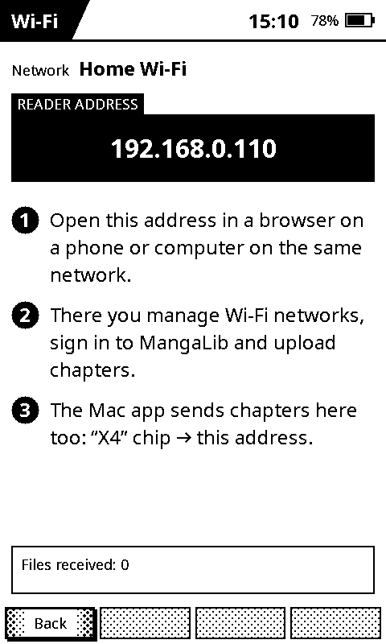 | 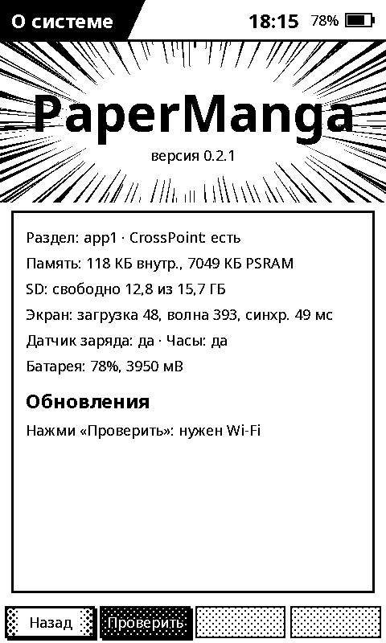 | |

## Прежний вариант X4 Classic 0.2.5

- В читалке два слота приложений. CrossPoint (наш форк) в первом, PaperManga во втором.
- Обновление по Wi‑Fi: в PaperManga «О системе» → «Проверить». Прошивки обновляют друг друга, потому что ни одна не может перезаписать слот, из которого работает. PaperManga ставит новый CrossPoint, а свою новую версию кладёт на карту, и CrossPoint ставит её при перезапуске. «Проверить обновления» в CrossPoint ставит последнюю PaperManga.
- Каждый выпуск содержит `papermanga.bin`, `crosspoint-manga-x4c.bin` и `release.json` с их размерами и SHA‑256. Читалка проверяет хеш перед установкой.
- Установщик не стирает флеш: загрузчик, таблица разделов и заводская калибровка экрана (NVS) не меняются.

## Источники манги

Читалка ничего не хранит и не раздаёт: главы скачиваются из источников, которые подключает сам пользователь (MangaDex, MangaLib с собственным входом). Права на мангу у её авторов и издателей.

## Лицензии

CrossPoint — © его авторы, лицензия MIT (см. `LICENSE-crosspoint`). Наш форк добавляет пункт PaperManga в меню и безопасные обновления.

Новые порты используют Arduino-ESP32 (LGPL-2.1-or-later), Inkplate (LGPL-3.0) или epdiy (LGPL-3.0-or-later), а также компоненты под MIT/Apache/BSD. Уведомления, лицензии, исходники библиотек и объектные файлы для повторной линковки находятся в файлах `THIRD_PARTY.md` и `papermanga-0.3.0-relink.zip` в [релизе](https://github.com/IKrasnodymov/papermanga/releases/tag/v0.3.0).
